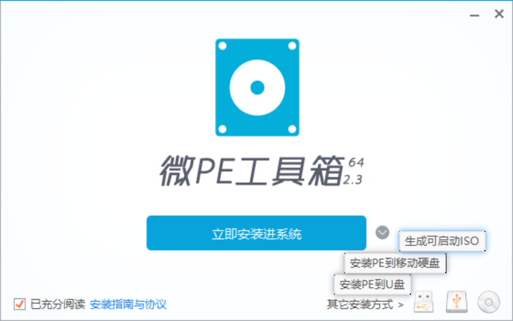
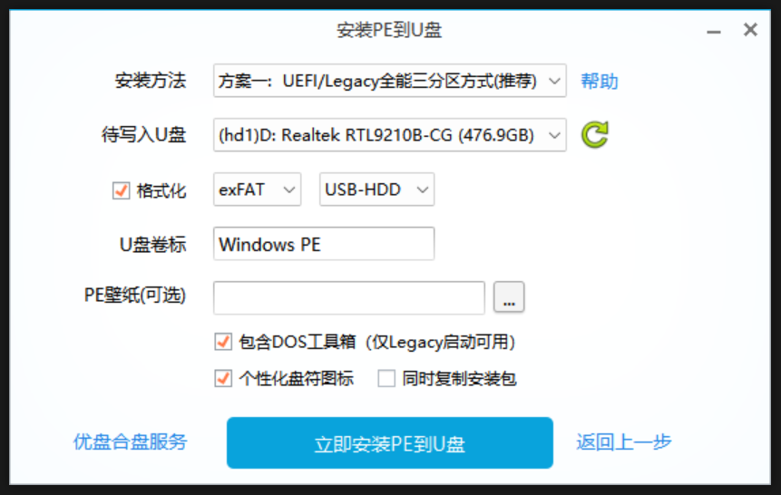

# UserManual_PC_System

用户手册 PC电脑系统

# Windows系统下载

[下载 Windows 10](https://www.microsoft.com/zh-cn/software-download/windows10)

[下载 Windows 11](https://www.microsoft.com/zh-cn/software-download/windows11)

* 使用该工具创建安装介质（USB 闪存驱动器、DVD 或 ISO 文件），以在其他 PC 上安装 Windows（单击可显示详细或简要信息）

* 直接安装，在装载 .iso 文件后，选择“sources/setup.exe”可跳过输入产品密钥

## 微PE系统

[微PE工具箱 - 超好用的装机维护工具](https://www.wepe.com.cn/)

使用PE系统安装，可直接选择根目录下的 setup.exe ，可跳过输入产品密钥

 

 

## 系统激活

1、右键 开始菜单

2、点击 终端管理员

3、输入 `irm https://massgrave.dev/get | iex` ，回车（注意空格）

​               `irm https://get.activated.win|iex`

4、在“Activation Methods”中选择“1”激活Windows，选择“2”激活Office

# 系统工具

| 功能           | 链接                                                         |
| -------------- | ------------------------------------------------------------ |
| PC工具箱       | [图吧工具箱 - DIY爱好者的必备工具合集](https://www.tbtool.cn/) |
| 系统维护工具   | [微PE工具箱 - 超好用的装机维护工具](https://www.wepe.com.cn/) |
| 压缩工具       | [7-Zip](https://7-zip.org/)                                  |
| Markdown编辑器 | [typora.io](https://typora.io/) (破解版)                     |
| 文件名搜索引擎 | (Everything) [voidtools](https://www.voidtools.com/zh-cn/)   |
| 截图工具       | [Snipaste - 截图 + 贴图](https://zh.snipaste.com/)           |
| 空格键极速预览 | [QuickLook - Windows 空格键极速文件预览工具](https://www.quicklook.org.cn/) |
| 影音解码器     | [Codec Guide: K-Lite Codec Pack - For Windows 11 / 10 / 8.1 / 7](https://www.codecguide.com/) |
| GIF屏幕录制    | [NickeManarin/ScreenToGif: 🎬 ScreenToGif allows you to record a selected area of your screen, edit and save it as a gif or video.](https://github.com/NickeManarin/ScreenToGif) |
| Github加速器   | [瓦特工具箱(Steam++官网) - Watt Toolkit](https://steampp.net/) |
| PDF阅读器      | [SumatraPDF - 轻量级免费PDF阅读器丨SumatraPDF阅读器手机版丨sumatrapdf下载](https://www.sumatrapdf.cn/) |
| 文档工具       | [WPS-支持多人在线协作编辑Word、Excel和PPT文档_WPS官方网站](https://www.wps.cn/) |
|                |                                                              |
|                |                                                              |

